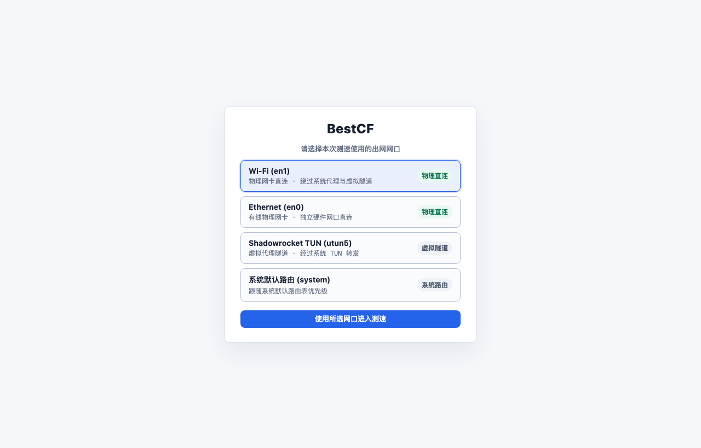
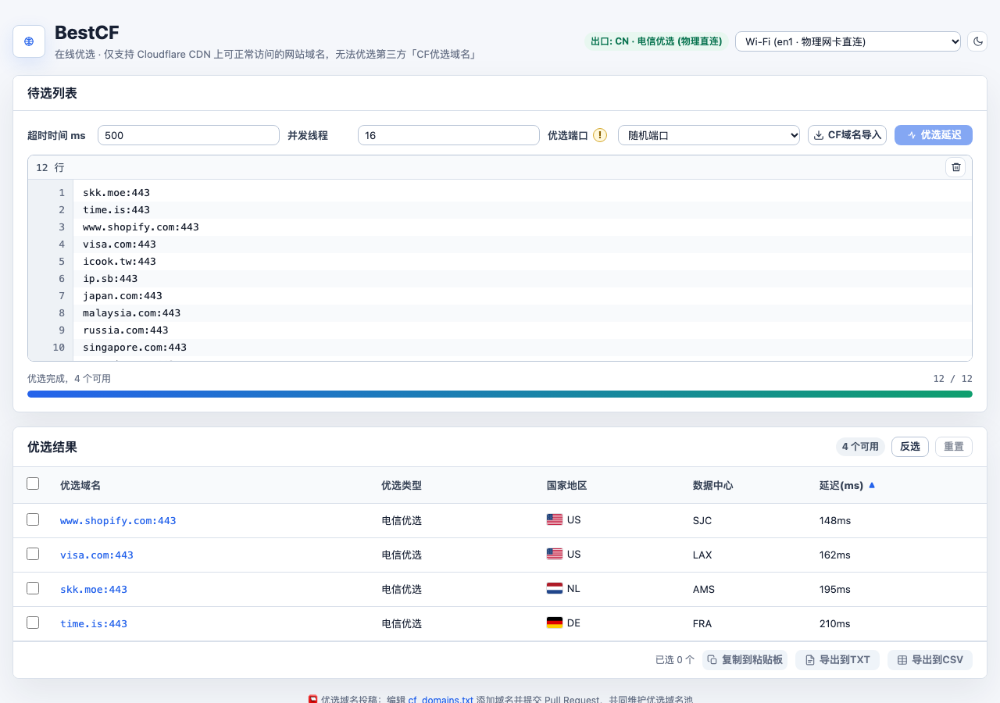

# ⚡ BestCF · CF 官方域名在线优选（macOS 多网口物理直连增强版）

基于 [`cmliu/CF-Pages-BestCF`](https://github.com/cmliu/CF-Pages-BestCF) 深度定制的 **macOS 多网口物理直连增强版**。除了完整保留原版 Cloudflare 官方域名在线优选能力外，新增了本地 **`server_2345.py` 内核级物理网卡绑定引擎（`IP_BOUND_IF`）** 与 **开屏 + 顶部双重网口热切换界面**，彻底解决开启 Shadowrocket（小火箭 TUN 模式）、Clash Tun 或双网卡/旁路由环境下无法直连优选、DNS Fake-IP 污染及 `Failed to fetch` 等问题。

---

## 🖼️ 界面预览（无本地 IP 隐私保护视图）

### 1. 启动前开屏网口选择界面
打开页面进入测速前，自动枚举本机活跃物理网卡（如 `Wi-Fi (en1)`、`Ethernet (en0)`）、虚拟代理隧道（`utun`）与系统默认路由，支持单击选择或双击直接进入测速：



### 2. 主界面与优选结果视图
顶部实时显示当前出口状态徽章与网口热切换下拉框；全局按钮与输入框高度统一对齐文字高度（`26px`），待选域名列表框精简为 10 行显示，「反选 / 重置」按钮内联收敛至「优选结果」标题行右侧：



---

## 🔍 对比原仓库 (`cmliu/CF-Pages-BestCF`) 的具体修改说明

| 模块维度 | 原仓库 (`cmliu/CF-Pages-BestCF`) | 本仓库定制修改版 (`iwhisper1011/CF-Pages-BestCF`) |
| :--- | :--- | :--- |
| **出网路由与代理穿透** | 纯浏览器直接发起 `fetch`，完全受制于系统默认路由、浏览器代理或 Shadowrocket / Clash 的 `utun` 虚拟网卡；开启代理时直接触发非 CN 拦截或因旁路由异常报 `Failed to fetch`。 | 新增 [`server_2345.py`](./server_2345.py) 本地直连引擎（端口 `2345`），利用 macOS XNU 内核 `setsockopt(IPPROTO_IP, IP_BOUND_IF, if_index)`（常量 `25`）将 Socket 强制绑定在选定的物理网卡（如 `en1` Wi-Fi），**无需关闭小火箭即可 100% 穿透虚拟隧道与旁路由**。 |
| **DNS 解析防污染** | 依赖系统默认 DNS，在 Fake-IP 模式下域名被解析为 `198.18.0.x` 导致测速失真或断连。 | 选择物理网卡时，[`server_2345.py`](./server_2345.py) 通过绑定该物理网卡的原始 UDP Socket 直接向公共 DNS（`223.5.5.5` / `119.29.29.29`）发送报文解析真实 A 记录并自动递归跟进 CNAME，彻底过滤 `198.18.0.0/15` Fake-IP。 |
| **网口选择交互（方案 C）** | 无网口感知能力，无法在双网卡（有线 `en0` + 无线 `en1`）之间指定测速线路。 | 实现**方案 C 双重网口控制**：<br>1. **启动前选择**：开屏弹出 `#bootIfSelector` 网口卡片列表，选定后再发起首次 CN 网络验证；<br>2. **主界面热切换**：顶部标题栏右侧新增 `#interfaceSelect` 下拉框与 `#currentIpBadge` 出口状态徽章，随时毫秒级切换网卡并自动清空连接池重测。 |
| **延迟测量精度** | 浏览器端 `fetch` 受跨域预检与浏览器连接调度影响，计时包含额外开销。 | 后端内置按 `(网卡, 域名, 端口)` 隔离的 **TLS Keep-Alive 连接池**，首包完成握手与参数校验后，后续 3 次串行测速复用已建立的 TLS 会话测量纯 HTTP 往返耗时，并通过响应头 `X-RTT-Ms` 精确回传前端。 |
| **控件尺寸与视觉一致性** | 按钮、输入框、下拉框高度较大（`36px~38px`），占用较多纵向空间。 | 修改 [`style.css`](./style.css)，将所有按钮（`.btn`）、数字输入框（`.input`）、下拉选择框（`.select`）及图标按钮（`.icon-btn`）高度统一压缩至 **`26px`**，与 `13px` 正文字高保持紧凑一致。 |
| **域名列表编辑框高度** | 编辑框默认高度较高（`360px` 以上），小屏下需频繁滚动才能看到下方结果表。 | 将 `.editor-body` 与 `#ipInput` 高度精确调整为 **`232px`（刚好完整显示 10 行域名）**，同屏即可完整浏览待选列表与优选结果。 |
| **优选结果操作栏布局** | 「反选」「重置」按钮原本位于表格其它区域，视觉动线分散。 | 修改 [`index.html`](./index.html) 与 [`style.css`](./style.css)，将 **「反选」「重置」按钮移动至「优选结果」标题行内**，紧贴在 `N 个可用` 状态标签右侧。 |
| **桌面化与一键启动** | 需手动打开终端执行 `python -m http.server` 再手输网址。 | 新增 [`start_2345.command`](./start_2345.command) 一键启动脚本与 macOS 原生 [`BestCF.app`](./BestCF.app) 桌面应用包，双击即可自动启动后台 `2345` 直连服务并拉起浏览器。 |

---

## 📂 核心文件变更清单

- **[`server_2345.py`](./server_2345.py)** *(新增)*：macOS 本地多网口直连测试服务，提供 `/__interfaces`（枚举网卡与网关）、`/__select_interface`（热切换绑定网口）、`/__direct_proxy`（基于 `IP_BOUND_IF` 与 TLS Keep-Alive 连接池的透明测速代理）。
- **[`index.html`](./index.html)** *(修改)*：
  - 顶部 `.hero` 栏新增 `#currentIpBadge` 出口状态徽章与 `#interfaceSelect` 网口切换下拉框；
  - 开屏遮罩 `#bootLoading` 内新增 `#bootIfSelector` 启动前网口选择器；
  - 「优选结果」头部 `.result-head-actions` 整合 `#resultCount`（`0 个可用`）、`#invertSelectBtn`（`反选`）与 `#clearSelectBtn`（`重置`）。
- **[`style.css`](./style.css)** *(修改)*：
  - 全局 `.btn`、`.input`、`.select`、`.icon-btn` 高度统一为 `26px`；
  - `.editor-body` / `#ipInput` 高度固定为 10 行（`232px`）；
  - 新增 `.boot-if-selector`、`.boot-if-item`、`.interface-select` 等网口选择器样式。
- **[`script.js`](./script.js)** *(修改)*：
  - 新增 `initInterfaceSelectionBoot()`、`renderBootIfList()`、`confirmBootInterfaceAndStart()`、`switchNetworkInterface()` 与 `updateCurrentIpBadge()`；
  - 改造 `fetchWithTimeout()` 自动将外部探测与测速请求路由至本地 `/__direct_proxy`，优先读取后端 `X-RTT-Ms` 高精度延迟头。
- **[`start_2345.command`](./start_2345.command) & [`BestCF.app`](./BestCF.app)** *(新增)*：macOS 快捷启动入口。

---

## 🚀 快速开始

### 方式一：macOS 本地多网口直连模式（推荐，支持跳过小火箭/旁路由）

```bash
git clone https://github.com/iwhisper1011/CF-Pages-BestCF.git
cd CF-Pages-BestCF

# 启动 2345 多网口物理直连测试服务
python3 server_2345.py
```

或者直接双击仓库内的 **`start_2345.command`** / **`BestCF.app`**，浏览器将自动打开 `http://127.0.0.1:2345`：
1. 在开屏弹窗中选择要走哪个出网网口（如挂着小火箭时直接选 `Wi-Fi (en1)` 即可物理直连）；
2. 进入主界面后点击 **「CF域名导入」** → **「优选延迟」**；
3. 测速过程中或测速后，可随时在右上角下拉框切换不同网口对比各线路延迟。

### 方式二：常规纯静态部署 / Cloudflare Pages 部署

若无需本地物理网卡绑定功能，本项目保持 100% 向下兼容：当检测到未运行 `server_2345.py` 时，前端会自动无缝回退至标准浏览器直连模式，可直接部署于 Cloudflare Pages 或任意静态 Web 服务器。

---

## 📄 License

[Apache-2.0](LICENSE)
